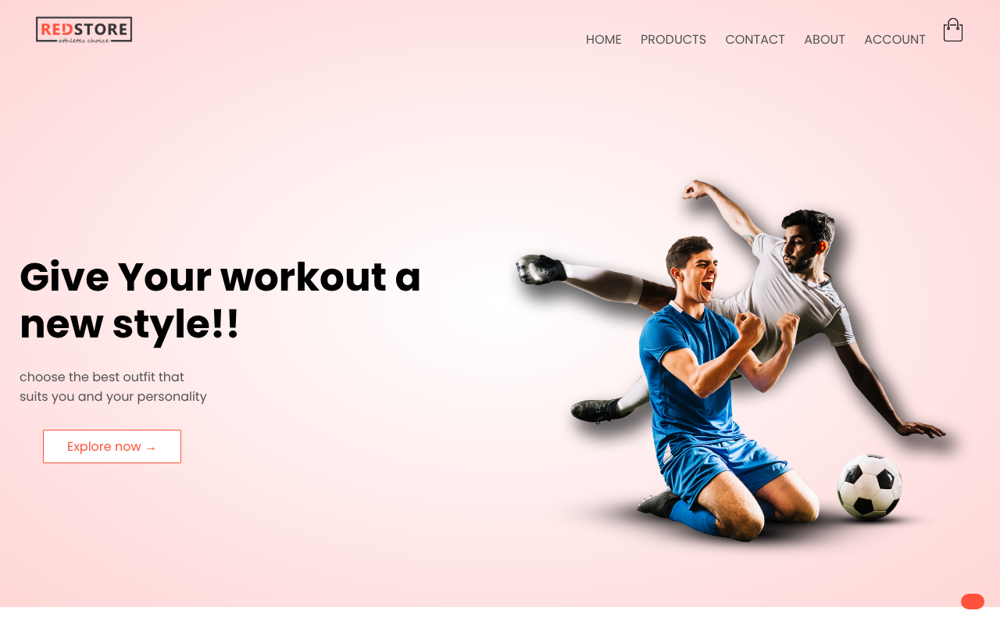

# RedStore

A multi-page e-commerce website design for a sportswear shop.

## Features

- Home, products, product details, cart, account, about and contact pages
- Product grid with pagination pages
- Login and register forms (design only)

## Run it

No build step. Open `index.html` in a browser, or serve the folder with any static server, for example `python -m http.server`.

## Notes

- Image credits are in `images/img-credit.txt`.

## Screenshots

